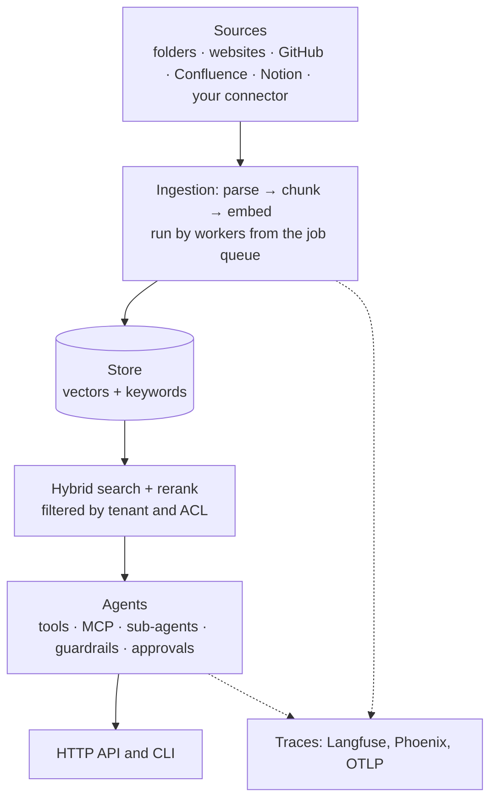

# Architecture

ragkit is split into small packages with one job each. They share a few data types
and plugin interfaces from `ragkit.core`.

## Packages

| Package | Responsibility |
|---|---|
| `ragkit-core` | Data types (`Document`, `Chunk`, `Query`), plugin interfaces, the plugin registry, `ragkit.yaml` loading, identities, telemetry helpers |
| `ragkit-retrieval` | Embedders, the SQLite and Postgres stores, hybrid search, rerankers, caches, `KnowledgeBase` |
| `ragkit-ingest` | Connectors, parsers, the chunker, the incremental pipeline, the job queue and workers |
| `ragkit-agents` | `agent.yaml` schema, the LangGraph runtime, retrieval wiring, MCP, approvals, sub-agents, guardrails, templates |
| `ragkit-observe` | Exporters for traces (Langfuse, Phoenix, OTLP, console) |
| `ragkit-evals` | Agent and search evals, the LLM judge, gates |
| `ragkit-server` | FastAPI gateway: chat, streaming, search, jobs, auth |
| `ragkit-cli` | The `ragkit` command |

Libraries depend only on the OpenTelemetry API, so tracing costs nothing until an
exporter is configured.

## Request path

1. The server authenticates the caller and sets their **identity** (tenant,
   principals, scopes) for the request.
2. The agent runtime loads the conversation from its **checkpointer**, then runs
   the agent graph: model calls, tool calls, retrieval, sub-agents.
3. Every search filters by the caller's tenant and ACL principals, inside the store.
4. Telemetry middleware records a span per model and tool call and adds up tokens
   and cost.
5. The reply streams back, or the turn stops to wait for a human approval.

## Ingestion path

1. A job is queued by the CLI, the HTTP API or the scheduler.
2. A worker claims it with a lease, then runs the pipeline for that collection.
3. Each connector lists the items in its source. Items whose content hash has not
   changed are skipped; new and changed items are parsed, chunked, embedded and
   stored; items no longer in the source are deleted (only when the listing
   completed).
4. The job's report is saved with the job.

## Local and cluster layouts

| | Local | Cluster |
|---|---|---|
| Store | SQLite file (`.ragkit/index.db`) | Postgres with pgvector |
| Job queue | SQLite file next to the index | Postgres |
| Agent memory | In process (`memory`) | Postgres (`postgres`) |
| Processes | One `ragkit serve` | API replicas, workers, one scheduler |

The same project runs in both: switch `store.backend`, set `database_url`, and set
`memory.checkpointer: postgres` in agents that need shared memory.
